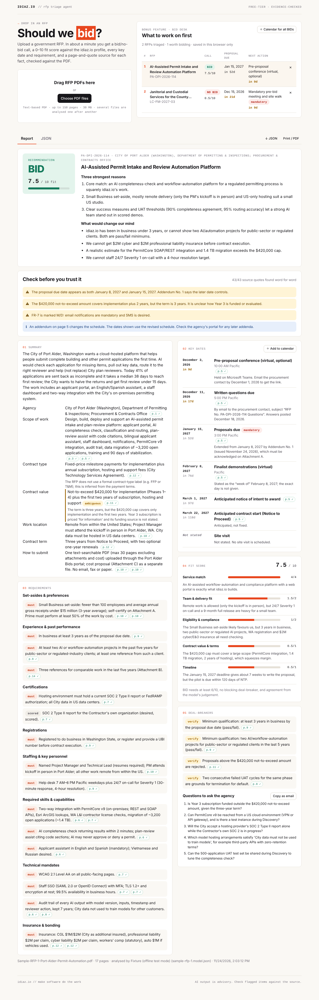

# RFP Triage Agent · idiaz.io Internship Challenge 2026

Drop in a government RFP PDF. In about a minute you get a **BID / NO_BID** call, a **0–10 fit score** against the idiaz.io profile, every key date and requirement, and a **page number plus verbatim quote** for each fact. Each quote is checked against the PDF text before you see it. The same report is available as JSON.



**Live link:** `<add your Vercel URL here>` · **Stack:** Next.js 15 (App Router, TypeScript) on Vercel Hobby + Google Gemini 3.8 Flash (free tier). No paid services, database or logins.

---

## What it returns

| Brief asks for | Where it is in the report / JSON |
|---|---|
| Summary in plain English | `summary` |
| Agency, scope, contract type & value, location, how to submit | `facts.*`, each with `value`, `status` (`stated` / `not_stated` / `ambiguous`), `note`, `evidence[]` |
| Key dates (Q&A cut-off, proposal due, site visit, work start) | `deadlines[]`: `what`, `date` (ISO), `time`, `timezone`, `mandatory`, `evidence[]`. Missing ones are always listed as "Not stated". |
| Skills, certifications, set-asides, clearances, past performance, staffing | `requirements[]`, grouped by `category`, with `mandatory` (must) vs scored |
| Fit score 0–10 with a one-line reason per factor | `fit_score`, `fit_factors[]` |
| Bid / no-bid, 3 strongest reasons, what would change its mind | `decision`, `reasons[3]`, `change_mind[]` |
| Deal-breakers and questions for the agency | `deal_breakers[]` (`blocking` / `verify`), `open_questions[]` (one click copies them as an email) |
| Flag ambiguity instead of guessing | `ambiguities[]` and `review_flags[]`, shown under "Check before you trust it" |

The top-level shape matches the brief's example (`decision`, `fit_score`, `deadlines[{what, date}]`, `requirements`, `reasons`), plus the extra fields above. Every evidence item carries a `check` result: `verified`, `relocated`, `approximate` or `unverified`.

## Bonus feature: Bid Desk

The brief pictures a bids lead on a Monday with three new RFPs, so the bonus feature is built for that moment.

- **Drop in several PDFs at once.** They are analysed one after another and collect in a ranked table: BIDs first, then by fit score, then by how soon the proposal is due.
- **Next action column.** Each row shows the nearest upcoming date (for example "Mandatory pre-bid meeting and site walk · in 9d"), so a mandatory site walk can't sneak past. Mandatory dates and anything due within 7 days are highlighted.
- **Calendar export (.ics).** Export one RFP's deadlines, or every deadline for all BIDs, into Outlook, Google Calendar or Apple Calendar. Reminders are set 3 days before proposal deadlines and 1 day before everything else.
- **Saved in the browser** (localStorage), so the desk survives a reload with no accounts or database.

**Why this one:** the expensive mistake in bid triage is rarely a single wrong field. It's working on the wrong RFP, or missing a mandatory walk-through date and being disqualified. Ranking plus a calendar turns the reports into a work plan.

**How it works:** `lib/desk.ts` (ranking and next action), `lib/ics.ts` (RFC 5545 export with all-day events, so a "3:00 PM Pacific" deadline never lands on the wrong day in another time zone), `components/BidDesk.tsx`.

A second, smaller extra is the **source viewer**. Click any `p.5 ✓` badge to open that page's extracted text with the quote highlighted. A reviewer can check a date in two seconds without opening the PDF.

## How it works

```
Browser                                   Server (Vercel function, 300 s max)
───────                                   ─────────────────────────────────
PDF ──► unpdf (pdf.js) reads every page   POST /api/analyze { fileName, pages[] }
        • checks it is a real PDF,            │ validate size / page count (zod)
          ≤30 MB, ≤150 pages                  ▼
        • rejects scanned PDFs             Gemini 3.8 Flash, low thinking, 
        • strips logo/seal noise           JSON schema enforced (responseSchema)
        ──── page text (JSON) ────►           │
                                              ▼
                                           zod validation of the model answer
                                              ▼
                                           Deterministic checks (lib/verify.ts)
                                           • every quote searched for on its page
                                           • every date must be written in its source
                                           • lines with 2+ dates → "revised date?" flag
                                           • addendum detector
                                           • requirement coverage check
                                           • missing key dates → "Not stated"
                                              ▼
                                           Scoring and decision rule (lib/score.ts)
Report ◄──────────── TriageReport JSON ──────┘
```

**Why the PDF is read in the browser:** Vercel's free functions accept request bodies of up to 4.5 MB, and a 100-page RFP with drawings can be much bigger. Sending only the text (about 370 KB for 100 dense pages) avoids that limit. It also gives instant errors for bad files, and the page text stays in the browser for the source viewer.

**Why one model call, not an agent framework:** the brief wants a trustworthy answer in about a minute. A single long-context call sees the whole RFP at once, including the appendices, where addenda and insurance terms hide. Deterministic code then checks the answer. A multi-step agent loop would add latency and cost without improving accuracy. The "agent" part is reading, judging, verifying itself and flagging what it isn't sure about.

### Model choice: Google Gemini 3.8 Flash

- **Free with no card.** You get an API key from Google AI Studio in one minute.
- **1M-token context.** A 100-page RFP (about 100k tokens) fits in one request, so nothing is chunked and nothing is missed.
- **Native structured output.** `responseSchema` makes the model return JSON in our exact shape, and zod validates it again on the server.
- **Fast enough.** In live runs on the two samples the reports took 35–47 s. When Google's free tier is overloaded it can be slower, so the function is allowed 300 s (the Vercel Hobby limit with Fluid compute). Thinking level `low` gives better judgement on dates and requirements without slowing it down much. (`gemini-2.5-flash` is no longer offered to new API keys, so the code also handles a retired model by moving to the next one.)
- **Automatic fallback.** If the main model is rate-limited (429), busy (503) or retired (404), it waits briefly and retries once (quota errors skip straight on), then tries `gemini-3.5-flash-lite` (500 requests/day on the free tier) and `gemini-3.7-flash`. Each attempt is capped at 90 s so an overloaded model can't stall the report. If a model rejects an optional setting (400), it retries once with only the essential settings.
- **Second provider when Gemini is busy.** Google's free tier is often overloaded (HTTP 503) or out of daily quota. If `FALLBACK_API_KEY` is set, the app switches to Mistral's free API (`mistral-small-latest`, OpenAI-compatible, long context) after one short retry. The report says which provider produced it, and the same schema validation and evidence checks apply. See `lib/openai-compat.ts`.
- **Alternatives considered.** Groq's free tier is faster, but its tokens-per-minute limit is too low for a 100-page document in one call. GitHub Models has smaller context limits. Self-hosted models need paid GPUs.

### How the fit score and decision are made

The model scores five factors and gives a one-line reason for each. The code clamps the points, adds them up and applies the rule, so the number can't drift from its explanation.

| Factor | Max | What it measures |
|---|---|---|
| Service match | 4 | Is the core work automation, compliance tooling, AI ops software, or web/mobile apps? |
| Team & delivery fit | 2 | Can a small senior team deliver it (remote, no field crews or 24/7 labour)? |
| Eligibility & compliance | 2 | Set-asides, registrations, certifications, clearances, insurance and bonds |
| Contract value & terms | 1 | Is it worth a proposal? |
| Timeline | 1 | Is there time to write and deliver? |

- **BID** only when the score is **≥ 6**, there's **no blocking deal-breaker**, and the model's own judgement agrees. Any disagreement is shown as a note and resolves to NO_BID, the conservative choice.
- **Fast no-bid:** if service match is 0 (construction, janitorial, supplies…), the score is capped at 2 and the report is labelled ⚡ fast no-bid.
- **Blocking vs verify:** a deal-breaker is *blocking* only when the RFP requires something the idiaz.io profile clearly rules out. Anything the profile doesn't cover (years in business, insurance limits, SOC 2, references, state registration) is *verify*, a question for the team, never an assumption. See `lib/profile.ts`.

### Ground rules from the brief, and how they're enforced

| Rule | How it's enforced |
|---|---|
| Use only the document | The prompt forbids outside knowledge, and every stated fact needs a verbatim quote. Quotes not found in the PDF are flagged `unverified` and the item is marked "check source". |
| Write "Not stated" | The schema requires `status`, and the four key dates are always shown (added as "Not stated" if the model omits them). |
| Flag ambiguity | `status: "ambiguous"` plus `ambiguities[]`. Lines with two dates and schedule-changing addenda are also detected by code, independently of the model. |
| None missed | The prompt sweeps a fixed checklist (insurance limits, bonds, wages, clearances, set-asides, certifications…). A code check then flags any of those topics that appear in the PDF but are missing from the extracted requirements, with page numbers. |
| Fast no-bid for work that isn't ours | Service-match gate and score cap (above). |

## Results on the two sample RFPs

| | Port Alder permit automation (17 pp.) | Larkspur janitorial (12 pp.) |
|---|---|---|
| Expected decision | **BID**: core AI/automation work, Small Business set-aside | **NO_BID** (fast): janitorial, not software |
| Traps the agent must catch | The proposal due date is printed as both Jan 8 and Jan 15, 2027; Addendum No. 1 sets **Jan 15, 3:00 PM Pacific**. There is no site visit. The $420k cap covers only 2 of the 3 contract years. | **Mandatory** site walk on Dec 3, 2026 (non-attendees are rejected); sealed paper bids only; contract value not stated |
| Ground truth | `evals/expected.json` | `evals/expected.json` |

`npm run eval` runs the full pipeline on both PDFs and checks the decision, score range, all four key dates, required requirement terms, that every quote is found in the PDF, and that it finishes in about a minute (90 s or less).

## Run it locally

Requirements: Node.js 20+ and a free Gemini API key.

```bash
npm install
cp .env.example .env.local        # then paste your key into GEMINI_API_KEY
npm run dev                       # http://localhost:3000
```

Get a key at <https://aistudio.google.com/app/apikey> (free, no card).

Useful scripts:

```bash
npm test                 # 33 unit tests: PDF reading, quote/date verification, scoring, Gemini client (mocked)
npm run eval             # live run on both sample RFPs against the ground truth (uses your key)
npm run eval -- --fixture  # same checks offline, using recorded answers
npm run typecheck
npm run build
npx tsx scripts/dump-pages.ts samples/Sample-RFP-1-Port-Alder-Permit-Automation.pdf   # see the text the model sees
```

`RFP_FIXTURE_MODE=1` makes the API replay recorded answers for the two sample RFPs, for UI work without a key. It is a test aid only. Never set it in production.

## Deploy (Vercel Hobby, free)

1. Push this folder to a GitHub repository. `.env.local` is git-ignored, so the key never enters the repo.
2. On <https://vercel.com/new>, import the repo. The framework is detected as Next.js; keep the defaults.
3. Under **Environment Variables**, add `GEMINI_API_KEY`, plus `FALLBACK_API_KEY` (a free Mistral key from console.mistral.ai) so reviewers still get a report when Gemini is busy. Optional: `GEMINI_MODEL`, `GEMINI_FALLBACK_MODELS`, `GEMINI_THINKING_LEVEL`, `RATE_LIMIT_PER_10_MIN`.
4. Deploy, open the URL and upload a sample RFP.

The API route sets `maxDuration = 300` (the Hobby maximum with Fluid compute, which is on by default for new projects). There's a light per-IP rate limit (12 analyses per 10 minutes per server instance) to protect the free model quota on a public link.

**Why Vercel:** zero-config Next.js hosting, a free HTTPS URL, and serverless functions for the one API route, with nothing to keep running.

## Project layout

```
app/page.tsx                 UI: upload, progress, Bid Desk, report / JSON tabs
app/api/analyze/route.ts     POST endpoint: validation, rate limit, timeout
components/                  Report, BidDesk, Evidence badges, SourceViewer
lib/pdf.ts                   PDF reading and cleaning (browser + Node)
lib/prompt.ts                System prompt with ground rules and rubric
lib/gemini.ts                Gemini REST client, response schema, model fallback
lib/openai-compat.ts         Backup provider (Mistral or any OpenAI-compatible API)
lib/schema.ts                zod schema for the model answer and report types
lib/verify.ts                Quote search, date checks, addendum detection
lib/score.ts                 Rubric, score cap, decision rule
lib/desk.ts, lib/ics.ts      Bonus feature: ranking and calendar export
lib/profile.ts               idiaz.io profile (from the brief) and the list of unknowns
evals/expected.json          Hand-checked ground truth for the samples
fixtures/                    Recorded model answers (tests / offline mode only)
tests/                       Vitest unit tests
```

## Known limitations

- **Text-based PDFs only.** Scanned PDFs are detected and rejected with a message to run OCR first. Strikethrough formatting is invisible in extracted text, so a struck-out date is caught through the "two dates on one line" flag and any addendum text, not by reading the formatting.
- **Up to about 150 pages / 600k characters per document.** Very long RFPs may need large appendices removed. Response time grows with length.
- **Free-tier quota.** Gemini's free tier is small: about 20 requests a day for Gemini 3.8 Flash and 500 for 3.5 Flash-Lite, resetting at midnight Pacific. When a model's quota is used up, the app moves to the next model at once and says so in plain words if all are exhausted. Google may use free-tier prompts to improve its products, so use the paid tier for confidential RFPs.
- **The fit score is only as good as the profile.** The profile in the brief is short, so unknowns become "verify" items rather than guesses.
- **The Bid Desk is stored per browser.** There's no sharing between teammates without a backend, which the brief puts out of scope.
- **The rate limiter is per serverless instance.** It's a guard for a demo link, not a security control.

## Assumptions

- idiaz.io is treated as a small business (a "small senior team") but **not** as holding any certification, clearance, state registration or insurance limit, because the brief doesn't say.
- The four key dates the brief names are always shown. Other dates (pre-proposal conference, award, demos) are added when present.
- "Week of" dates use the first day, with a note.

## Credits and licences

- All code in this repository is original work, written for this challenge. MIT licence (see `LICENSE`).
- Ideas reviewed (no code copied):
  - [DerJams/bidtriage](https://github.com/DerJams/bidtriage): verifying each extracted field against the source, and picking the controlling date when addenda disagree.
  - [killyx/ai-rfp-triage-agent](https://github.com/killyx/ai-rfp-triage-agent): structured outputs and a human-review flag.
  - [aadrikasingh/AI-Powered-RFP-Analyzer](https://github.com/aadrikasingh/AI-Powered-RFP-Analyzer) (MIT) and [papajo/Consultant-in-a-Box](https://github.com/papajo/Consultant-in-a-Box) (MIT): upload-to-report flow.
- Dependencies: Next.js (MIT), React (MIT), zod (MIT), unpdf (MIT), which bundles Mozilla pdf.js (Apache-2.0).
- The sample RFPs in `samples/` are fictional test documents provided by idiaz.io for this challenge.
